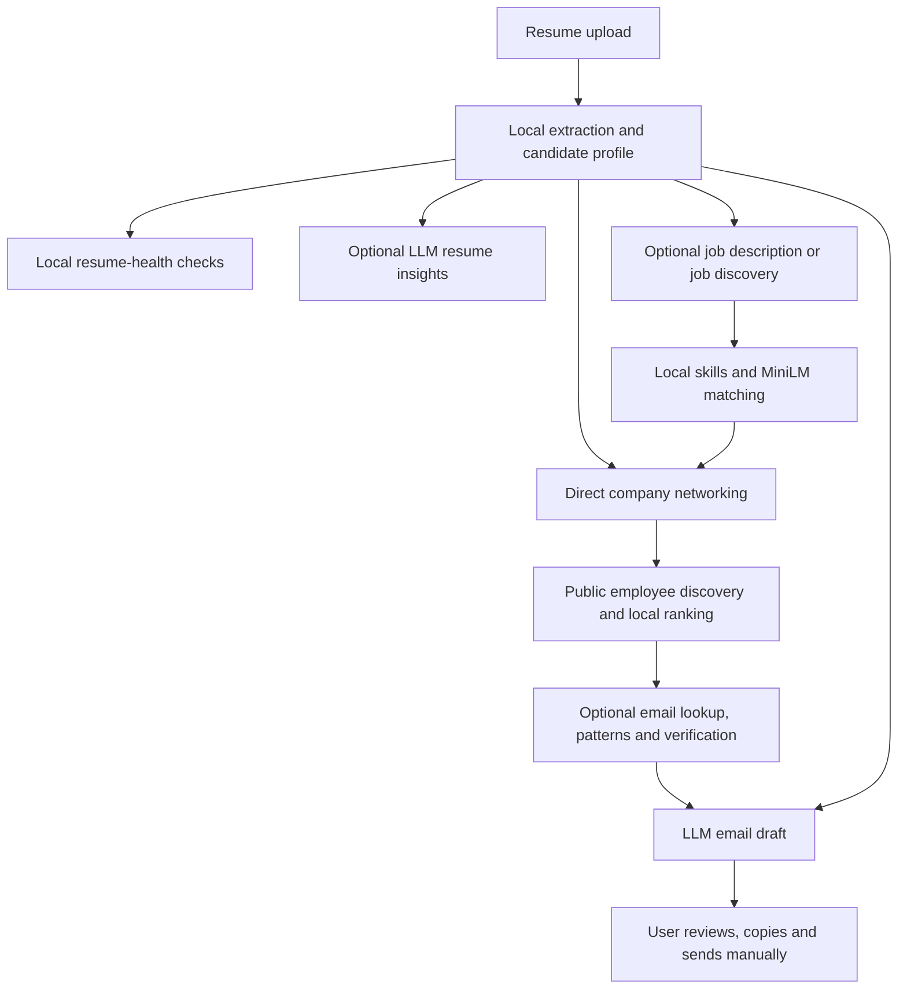

# CareerBridge AI

CareerBridge AI helps students and early-career applicants review a resume, compare it with a job description, find relevant people at a company, and draft a personalized networking or referral email.

**Local NLP extracts and scores the evidence. External services discover contacts and emails. An API-based LLM generates resume feedback and email drafts.** Job matching is optional for networking. The user reviews and sends every email manually.

## Features

- **Resume review:** PDF, Word (.docx), and TXT extraction into an editable candidate profile.
- **Resume health:** separate ATS-readiness and content-quality scores, with evidence and assessment coverage.
- **AI insights:** up to two specific improvements grounded in project or experience statements.
- **Job comparison:** paste a description or upload PDF/DOCX, review the text, and calculate a job-specific match.
- **Jobs for you:** opening Job Match automatically searches using resume skills and likely roles, then shows up to five ranked postings with application links.
- **Flexible outreach:** compare a known company's description or use a person you already know.
- **Contact discovery:** public search evidence and local relevance ranking for technical employees, managers, and recruiting staff.
- **Email discovery:** company-domain lookup, optional Hunter/Apollo enrichment, name-based patterns, and verification status.
- **Email drafting:** networking, referral, or job-application drafts with four tone choices.
- **Resume export:** download the reviewed profile as a new PDF.

## Architecture



| Task | Implementation | External API? |
|---|---|---|
| Read documents | PyMuPDF and python-docx | No |
| Extract names, sections, skills, and requirements | spaCy, regex, dictionaries, and Python rules | No |
| Calculate resume health | Weighted local rules | No |
| Compare resume/job meaning | MiniLM embeddings and cosine similarity | No |
| Calculate job-specific match | Local skills, semantic, project, experience, and education scores | No |
| Search public jobs/employees | Tavily, HTTPX, Beautiful Soup, optional Playwright | Yes for search |
| Rank contacts and generate email patterns | Local role and name/domain rules | No |
| Find and verify professional emails | Hunter/Apollo and DNS checks | Yes for provider calls |
| Generate insights and drafts | NVIDIA primary provider with optional Groq fallback | Yes |

MiniLM is a pretrained embedding model stored locally. It compares meaning and does not generate text. This project does not train or fine-tune an LLM.

## Technology stack

| Area | Tools |
|---|---|
| Frontend | React, Vite, CSS, Phosphor icons |
| Backend | Python, FastAPI, Uvicorn, Pydantic |
| Documents | PyMuPDF, python-docx |
| Local NLP | spaCy, sentence-transformers, scikit-learn |
| Web/email discovery | HTTPX, Beautiful Soup, Playwright, dnspython |
| Storage | SQLite |
| Testing | pytest and Node's built-in test runner |

## Project structure

```text
CareerBridge-AI/
├── backend/
│   ├── main.py                 # FastAPI application
│   ├── config.py               # Settings, paths, limits and score weights
│   ├── models.py               # Request/response validation schemas
│   ├── storage.py              # SQLite record storage
│   ├── routes/                 # Resume, jobs, matching, contacts and email APIs
│   ├── nlp/                    # Extraction, normalization, health and matching
│   ├── services/               # Search, email lookup, LLM calls and PDF export
│   ├── data/                   # Skill dictionary and aliases
│   ├── requirements.txt        # Direct Python dependencies
│   └── requirements-lock.txt   # Recorded dependency versions
├── frontend/
│   ├── src/                    # React pages, components, styles and helper tests
│   ├── public/                 # Static assets
│   ├── package.json            # Frontend scripts and dependencies
│   └── vite.config.js          # Development server and API proxy
├── examples/                   # Fictional resume, jobs and labelled skill data
├── evaluation/                 # Saved classroom evaluation results
├── tests/                      # Python tests
├── download_models.py          # Download spaCy and MiniLM models
├── evaluate.py                 # Run sample NLP evaluation
├── .env.example                # Configuration template; no credentials
└── README.md
```

`models/`, `.venv/`, `frontend/node_modules/`, and `backend/data/app.db` are created locally and excluded from Git.

## Installation

Tested with **Python 3.13** and **Node.js 22**. Install Python, Node.js/npm, and Git first.

### 1. Clone the project

The GitHub repository name ends with a dot. The command below uses that exact URL and creates a directory named `CareerBridge-AI`.

```bash
git clone https://github.com/rudraXWork/CareerBridge-AI..git CareerBridge-AI
cd CareerBridge-AI
```

### 2. Set up Python and the local models

macOS/Linux:

```bash
python3.13 -m venv .venv
source .venv/bin/activate
python -m pip install -r backend/requirements.txt
cp .env.example .env
python download_models.py
```

Windows PowerShell:

```powershell
py -3.13 -m venv .venv
.venv\Scripts\Activate.ps1
python -m pip install -r backend/requirements.txt
Copy-Item .env.example .env
python download_models.py
```

The downloader installs spaCy's `en_core_web_sm` and saves `all-MiniLM-L6-v2` under `models/`. Downloading needs internet access; model inference uses local files afterward.

`requirements-lock.txt` records exact versions from the development environment. `requirements.txt` lists direct dependencies and supported ranges.

### 3. Install frontend dependencies

```bash
cd frontend
npm ci
cd ..
```

## API configuration

Edit the local `.env`. **Resume extraction, health checks, PDF export, and supplied-description matching do not require provider API keys.**

| Variable | Purpose |
|---|---|
| `LLM_API_KEY` | Primary provider key for AI insights and email drafts |
| `LLM_BASE_URL` | Primary OpenAI-compatible API endpoint |
| `LLM_MODEL` | Primary model ID |
| `GROQ_API_KEY` | Optional fallback for insights and drafts |
| `TAVILY_API_KEY` | Public job, employee, and company-domain search |
| `HUNTER_API_KEY` | Optional domain/email lookup and email verification |
| `APOLLO_API_KEY` | Optional professional-email lookup fallback |
| `USE_PLAYWRIGHT` | Enable browser fallback for public pages with little static text |

Current primary configuration:

```dotenv
LLM_API_KEY=
LLM_BASE_URL=https://integrate.api.nvidia.com/v1
LLM_MODEL=openai/gpt-oss-20b
GROQ_API_KEY=
TAVILY_API_KEY=
HUNTER_API_KEY=
APOLLO_API_KEY=
USE_PLAYWRIGHT=false
```

Groq fallback uses `openai/gpt-oss-120b`. A primary-provider failure or unusable response triggers one fallback attempt with the same context. Live calls require credentials and provider quota. Restart the backend after changing `.env`.

For optional browser fallback, run `python -m playwright install chromium` and set `USE_PLAYWRIGHT=true`. Normal HTTP fetching is tried first. The app does not log in to public sources or bypass access restrictions.

Commit `.env.example` as a template; actual credentials belong in the ignored `.env`.

## Run locally

Use two terminals.

**Terminal 1 — backend**, from the project root with the Python environment activated:

```bash
python -m uvicorn backend.main:app --host 127.0.0.1 --port 8000
```

**Terminal 2 — frontend:**

```bash
cd frontend
npm run dev
```

- Application: [http://127.0.0.1:5173](http://127.0.0.1:5173)
- Interactive API docs: [http://127.0.0.1:8000/docs](http://127.0.0.1:8000/docs)
- Backend readiness: [http://127.0.0.1:8000/health](http://127.0.0.1:8000/health)

Vite forwards `/api` requests to port `8000`. Open the Vite URL to use the app. Press **Ctrl+C** in each terminal to stop it.

`cd frontend && npm run build` creates the production frontend bundle in `frontend/dist/`. Deployment also needs a backend/API proxy. The development application has no authentication or multi-user isolation.

## Using the app

1. **Upload and review a resume.** Health appears before the candidate profile. Correct fields with **Edit details** and optionally generate AI insights.
2. **Choose a route.**
   - **I know the company:** enter a company, role, and description. Paste text or upload PDF/DOCX, review it, then click **Get match score**.
   - **Jobs for you (default):** recent jobs are searched automatically without company details. Review the five highest matches, open **Apply on source**, or choose **Find contacts**. Role, company, location, and job-type filters are optional.
   - **I know the person:** supply a contact and email; a job description is optional.
   - **Contacts directly:** search a company for networking or referrals without a listing or match.
3. **Review contacts.** A selected job carries its company and role into discovery. Source evidence and relevance scores are shown.
4. **Find an email if needed.** Lookup and pattern fallback are optional. Review the source and verification status.
5. **Generate a draft.** Choose a tone and purpose, review the subject/body, and copy it into your email application.

Classroom samples contain fictional data. AI insights suggest changes and do not edit the resume automatically. PDF export creates a new document from the reviewed profile.

Job discovery uses up to three Tavily advanced searches across individual LinkedIn and supported job-board postings, with a one-month search filter. It reads available JobPosting metadata or public job-page fields. For LinkedIn, it uses substantive indexed descriptions if the title and employer are supported by that text, avoiding repeated requests to blocked pages. Indexed results are labelled **opening unconfirmed**, and dates inferred from relative posting ages are approximate. Known expired listings and known dates outside the recent window are excluded from automatic discovery. Search coverage can be incomplete; fewer than five usable results are shown honestly. Tavily searches use provider credits. Only role/skill/filter terms are sent in the search query, not the candidate's name, email, or full resume.

## Scoring and interpretation

### Resume health

Resume health averages ATS readiness and content quality.

- **ATS readiness:** extractable text, contact details, sections with content, and supported layout/formatting checks.
- **Content quality:** action verbs, measurable results, detail, length, repetition, and core content.

Scores use **earned points ÷ assessed weight × 100**. Unassessed checks are excluded. PDF table, text-box, and header/footer-email checks are unassessed, so coverage is normally 75%. A score of 100 means all assessed checks passed; it is not full ATS compatibility or an employer's ATS result.

### Job-specific match

| Component | Starting weight |
|---|---:|
| Skills | 40% |
| Semantic similarity | 25% |
| Project relevance | 20% |
| Experience | 10% |
| Education | 5% |

MiniLM embeds the candidate context and description. Cosine similarity measures alignment, and Python combines it with skill overlap and other evidence. Unavailable components are excluded and weights redistributed. Descriptions shorter than 30 words are not given an overall score. Without MiniLM, skill comparisons remain available but the overall score is unavailable.

### Contact and email results

Contacts use local role (40%), department (30%), hiring relevance (20%), and seniority (10%) rules. Public records and search snippets are leads; current employment needs review.

Email discovery resolves the company domain, tries Hunter then Apollo when configured, and optionally tries company/name patterns. DNS/MX checks describe mail infrastructure, not an individual mailbox.

| Status | Meaning |
|---|---|
| Verified | Provider reports valid/verified deliverability |
| Likely | Catch-all/accept-all; individual mailbox remains uncertain |
| Public | Public source evidence without confirmed deliverability |
| Inferred | Name/domain pattern guess |
| Unknown | Supplied email or insufficient verification evidence |

## Testing and evaluation

From the project root with the Python environment activated:

```bash
python -m pytest -q
node --test frontend/src/projects.test.js frontend/src/insights.test.js
HF_HUB_OFFLINE=1 TRANSFORMERS_OFFLINE=1 python evaluate.py
```

The latest local check passed **151 Python tests and 10 frontend helper tests**. External providers are mocked in tests. Model-dependent tests require downloaded MiniLM files.

`evaluation/results.json` contains eight labelled skill examples and three fictional job comparisons. Saved high/medium/low matches scored **87.02%, 53.01%, and 10.39%**. These classroom examples are not a broad benchmark or hiring prediction.

## API endpoints

| Method | Endpoint | Purpose |
|---|---|---|
| GET | `/health` | Model/provider readiness |
| POST | `/resume/upload` | Resume upload; returns profile and health |
| POST | `/resume/analyze` | Recheck a reviewed profile |
| POST | `/resume/insights` | Generate up to two AI improvements |
| POST | `/resume/download` | Export the reviewed profile as PDF |
| POST | `/jobs/upload` | Extract PDF/DOCX job-description text |
| POST | `/jobs/analyze` | Parse a description or resolve a public job URL |
| POST | `/jobs/search` | Discover and rank job listings |
| POST | `/match` | Calculate the local job match |
| POST | `/contacts/find` | Discover/rank contacts and optionally find emails |
| POST | `/email/generate` | Generate a subject/body draft |

See `/docs` for request schemas and interactive examples.

## Troubleshooting

| Issue | Action |
|---|---|
| Backend unavailable | Start Uvicorn on port 8000 and Vite on port 5173 |
| Port already in use | Stop the previous server before restarting |
| MiniLM missing / match unavailable | Run `python download_models.py` |
| AI request fails | Check model/base URL, keys, quota, and optional Groq fallback; restart after configuration changes |
| No people or listings found | Try a specific company or broader role, or supply a known person/description |
| PDF has no readable text | Use OCR to obtain selectable text before upload |
| Word upload fails | Use a valid `.docx`; legacy `.doc` is unsupported |
| File too large | Uploads accept files up to 5 MB |

## Scope and limitations

- English rules can miss unusual names, layouts, headings, and requirements.
- Semantic inputs use the model's token limit; full-document chunking is not implemented.
- Public pages and provider data can be stale, blocked, or incomplete.
- Email patterns do not establish mailbox ownership or deliverability.
- AI output is checked for structure and selected unsupported changes, but needs factual review.
- SQLite stores local records; there is no account system or multi-user isolation.
- The project does not send emails, track opens, or automate follow-ups.
